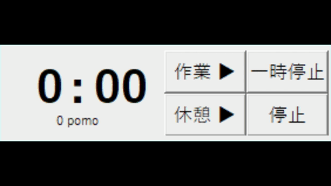

# Pomodoro-Timer

Pmodoro Timer is a timer application for [Pomodoro techniqu](https://en.wikipedia.org/wiki/Pomodoro_Technique).
25-minute and 5-minute timers are available.

Pomodoro Timerは、いわゆる[ポモドーロテクニック](https://ja.wikipedia.org/wiki/%E3%83%9D%E3%83%A2%E3%83%89%E3%83%BC%E3%83%AD%E3%83%BB%E3%83%86%E3%82%AF%E3%83%8B%E3%83%83%E3%82%AF)用のタイマーアプリケーションです。
25分と5分のタイマーが用意されています。

# DEMO

<p align="center">
  
</p>

# Features

There are many other timers for the Pomodoro technique, but this timer has the following advantages:

- This can pause the timer.
- This can be stopped in the middle.
- This does not put your PC to sleep or wake up. (Use the keyboard regularly)
  The following are the normal functions of the timer for the Pomodoro technique (what I think)
- A work timer (25-minute timer) and a break timer (5-minute timer) are available.
- Flashe and sound when the timer expires (Display in the foreground)
- Displays the number of work sessions started, highlighting every fourth session.

ポモドーロテクニック用のタイマーは他にもたくさんありますが、以下の点で優れています。

- タイマーを一時停止することができる。
- 途中で停止することができる。
- PCをスリープや停止させない。（定期的にキーボード操作をします）
  以下は、通常のポモドーロテクニック用タイマーの機能（っと思っているもの）
- 作業タイマー（25分タイマー）と休憩タイマー（５分タイマー）が用意されています。
- タイマーが終了すると、点滅と音で知らせます。（最前面に表示します）
- 作業タイマーの開始回数を表示し、4回ごとに強調表示します。（一時停止からの再開はカウントされません）

# Requirement

- python
- pyautogui

(windows10での使用を前提としています。)

# Usage

```bash
python pomodoro_timer.py
```

# Note
